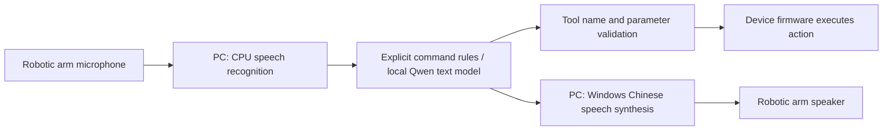

# AMD Ryzen AI Local Voice Services for a Robotic Arm

[简体中文](README.md) | **English**

[Project website and technical documentation](https://shilicon.github.io/P100_robotic_arm/)

Run speech recognition, a text language model, and speech synthesis on a Windows PC so that compatible ESP32-S3 robotic arm firmware can respond to Chinese instructions through tool calls. The default text model is AMD's Qwen3-8B deployment for the Ryzen AI 1.8.0 NPU runtime with a 4K context window.

**This repository contains the PC backend, protocol documentation, and independently written tests and authentication integration code. The vendor's robotic arm firmware, motion implementations, sounds, and animations are not included because permission to redistribute them has not been obtained.** Connecting a physical device requires compatible firmware that you are authorized to use.

## Capabilities and limitations

- Speech recognition: SenseVoice int8, running on the CPU in a separate Python process.
- Language understanding: Qwen3-8B, targeting AMD Ryzen AI NPU inference. Some simple commands that fully match a rule are converted directly into tool calls.
- Speech output: the Microsoft Huihui Chinese voice through Windows SAPI, running on the CPU.
- Actions: the backend returns tool names and parameters; device firmware executes predefined motions or bounded movements. At most one action is returned per turn, with parameter types and ranges validated.
- No vision-language model, visual grasping, reinforcement learning policy, or model that directly generates motor trajectories is included. A camera preview does not provide image understanding.

The project originally referred to its target hardware as "AMD P100," but an exact SKU, driver records, and reproducible hardware measurements are currently unavailable. Compatibility with Ryzen AI 1.8.0 and the selected model has therefore not been confirmed. See [hardware and validation status](docs/HARDWARE.md). Latency and success-rate figures from the original deployment notes are not treated as verified results.



A tool response of `accepted` means only that the request was accepted, not that the action has completed. The existing device behavior of `self_arm_stop` is to stop and then return to the home position, which still moves the arm; it is not a substitute for a hardware emergency stop. Language rules and parameter validation do not guarantee physical safety.

## Repository layout

| Path | Contents |
| --- | --- |
| `app/` | PC backend, worker processes, conversation rules, and streaming logic |
| `prompts/` | Independently maintained prompts |
| `scripts/` | Utilities for configuration, setup, model verification, and testing |
| `tests/` | Offline regression tests and service integration tests that do not execute device actions |
| `firmware-integration/` | Independent authentication headers and device integration instructions; no vendor implementation |
| `manifests/models.json` | Pinned external model revisions, file sizes, and checksums |
| `docs/` | Protocol, setup, model licensing, and hardware documentation |
| `website/index.html` | Project website |

## Run offline tests

Windows, macOS, or Linux with Python 3.12 / 3.13:

```sh
python -m venv .venv-test
# After activating .venv-test:
python -m pip install -r requirements-test.txt
python scripts/test_offline.py
```

The tests generate temporary keys and do not read your actual service keys, load models, or access the robotic arm. If a C++ compiler is available, they also compile and verify the firmware authentication functions; otherwise, that check is explicitly reported as skipped. See [testing documentation](docs/TESTING.md) for details.

## Deploy on Windows with a physical device

1. Confirm that your exact CPU/NPU model is supported by AMD Ryzen AI 1.8.0. Follow the [official AMD documentation](https://ryzenai.docs.amd.com/en/latest/hybrid_oga.html) to install the corresponding drivers, runtime, and Python 3.12 environment.
2. Install the Microsoft Huihui Chinese SAPI voice on Windows.
3. Run the setup script in PowerShell, replacing the example paths and PC LAN address:

```powershell
.\scripts\setup.ps1 -AmdPython "C:\path\to\amd-env\python.exe" -AmdInstallation "C:\path\to\RyzenAI\1.8.0" -LanHost "192.0.2.10"
```

`192.0.2.10` is a documentation example address and cannot be used as your actual deployment address. By default, services listen only on the local machine. To allow device access over the LAN, add `-ListenLan` during initial setup or change `host` to `0.0.0.0` in the generated private `config.json`. The script preserves an existing configuration; arguments supplied on subsequent runs do not overwrite it.

The backend environment inherits AMD's native inference packages, while ASR uses a separate `.venv-asr` environment. Do not install the standard `onnxruntime` package in the backend environment and overwrite AMD's version. For manual updates to existing environments, see the [setup guide](docs/SETUP.md).

4. Read the [model sources and licensing information](docs/MODELS.md), then download the models after accepting their applicable terms. The files total approximately 11.15 GB in decimal units and are not included with the source code. Downloading them does not start the services.

```powershell
.\.venv\Scripts\python.exe scripts/models.py download --accept-model-terms
.\.venv\Scripts\python.exe scripts/models.py verify
.\.venv\Scripts\python.exe scripts/doctor.py
```

5. Follow the [device integration instructions](firmware-integration/README.md) to configure separate keys for each direction of communication in firmware you are authorized to use. The setup script does not change firewall settings or flash firmware. When listening on the LAN, expose the required ports only to trusted devices.
6. Start and check the services on Windows:

```powershell
.\.venv\Scripts\python.exe app/control.py start
.\.venv\Scripts\python.exe app/control.py status
# To stop the PC services:
.\.venv\Scripts\python.exe app/control.py stop
```

Initial downloads and installation require an internet connection. Once the files are available, backend inference uses local models. Whether the device firmware also contacts vendor cloud services must be reviewed separately by the firmware holder. Using this local backend does not guarantee that the entire device operates offline.

Offline tests do not replace validation on Windows, the NPU, or a physical robotic arm. See the [testing record](docs/TESTING.md) for the current status.

## License

The project's own backend and independently added files are licensed under [Apache-2.0](LICENSE); see [NOTICE](NOTICE) for the scope. External models, the AMD runtime, Windows voices, and vendor firmware remain subject to their respective terms, as described in the [third-party notices](THIRD_PARTY_NOTICES.md). This project is not officially affiliated with or endorsed by AMD or the robotic arm vendor.
