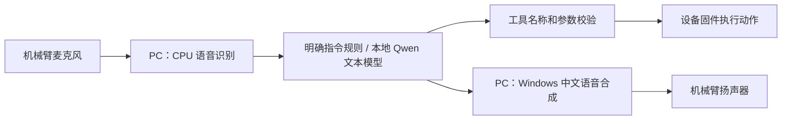

# AMD Ryzen AI 本地语音机械臂服务（实验性）

在 Windows PC 上运行语音识别、文本大模型和语音合成，让兼容的 ESP32-S3 机械臂固件通过工具调用响应中文指令。默认文本模型是 AMD 提供的 Qwen3-8B Ryzen AI 1.8.0 NPU 4K 部署版本。

**本仓库发布的是 PC 后端、协议说明、独立编写的测试与鉴权接入代码。厂商机械臂固件、动作实现、声音和动画没有取得再分发授权，不随仓库提供。** 连接实物需要另行取得合法的兼容固件。

## 实际能力与边界

- 语音识别：SenseVoice int8，在独立 CPU Python 进程中运行。
- 语言理解：Qwen3-8B，目标运行环境为 AMD Ryzen AI NPU；部分完整匹配的简单指令由规则直接转换为工具调用。
- 语音输出：Windows SAPI 的 Microsoft Huihui 中文语音，在 CPU 上运行。
- 动作：后端返回工具名称及参数，由设备端执行既有动作或受限位移。每轮最多返回一个动作，校验参数类型和范围。
- 不包含视觉语言模型、视觉抓取、强化学习策略或直接生成电机控制轨迹的模型。摄像头预览不等于图像理解。

项目最初使用“AMD P100”描述目标硬件，但当前没有准确 SKU、驱动记录和可复现的硬件测量，不能确认与 Ryzen AI 1.8.0 及所选模型兼容。请先查阅 [硬件与验证状态](docs/HARDWARE.md)。不将原部署说明中的时延和成功率作为已验证指标。



工具返回 `accepted` 只代表请求被接受，不代表动作完成。`self_arm_stop` 的已有设备语义是停止后归位，仍会移动机械臂，不能代替硬件急停。语言规则和参数校验也不构成物理安全保证。

## 目录

| 路径 | 内容 |
| --- | --- |
| `app/` | PC 后端、工作进程、对话规则与流式处理 |
| `prompts/` | 独立维护的提示词 |
| `scripts/` | 配置生成、安装、模型校验、测试和公开包导出 |
| `tests/` | 离线回归测试与不执行设备动作的服务集成测试 |
| `firmware-integration/` | 独立鉴权头文件与设备接入说明，不含厂商实现 |
| `manifests/models.json` | 外部模型的固定版本、文件大小及校验值 |
| `docs/` | 协议、模型许可、硬件与发布边界 |

## 只运行离线测试

Windows、macOS 或 Linux，Python 3.12 / 3.13：

```sh
python -m venv .venv-test
# 激活 .venv-test 后执行：
python -m pip install -r requirements-test.txt
python scripts/test_offline.py
```

测试会生成临时密钥，不读取你的实际服务密钥，不加载模型，不访问机械臂。有 C++ 编译器时还会编译并验证固件鉴权函数；没有编译器时明确报告跳过。细节见 [测试说明](docs/TESTING.md)。

## Windows 实机部署

1. 核实具体 CPU/NPU 型号在 AMD Ryzen AI 1.8.0 的支持列表中，按 [AMD 官方文档](https://ryzenai.docs.amd.com/en/latest/hybrid_oga.html) 安装对应驱动、运行时和 Python 3.12 环境。
2. 安装 Windows 中文 SAPI 语音 Microsoft Huihui。
3. 在 PowerShell 中运行安装脚本，替换示例路径和 PC 局域网地址：

```powershell
.\scripts\setup.ps1 -AmdPython "C:\path\to\amd-env\python.exe" -AmdInstallation "C:\path\to\RyzenAI\1.8.0" -LanHost "192.0.2.10"
```

`192.0.2.10` 是文档示例地址，不能直接用于部署。默认只监听本机；让设备访问时，在首次安装加 `-ListenLan`，或在生成的私有 `config.json` 中将 `host` 改成 `0.0.0.0`。脚本保留已有配置，后续传入参数不会覆盖它。

后端环境继承 AMD 的原生推理包，ASR 使用单独 `.venv-asr`。不要在后端安装普通版 `onnxruntime` 覆盖 AMD 的版本。已有环境的手动更新方式见 [安装说明](docs/SETUP.md)。

4. 阅读 [模型来源与许可](docs/MODELS.md)，确认接受各模型的条款后下载。全部文件约 11.15 GB（十进制），不随源码包提供；下载不会启动服务。

```powershell
.\.venv\Scripts\python.exe scripts/models.py download --accept-model-terms
.\.venv\Scripts\python.exe scripts/models.py verify
.\.venv\Scripts\python.exe scripts/doctor.py
```

5. 按 [设备接入说明](firmware-integration/README.md) 在你有权使用的固件中接入双向独立密钥。安装脚本不修改防火墙、不刷写固件；局域网监听时，应仅向可信设备开放所需端口。
6. 在 Windows 上启动并测试服务：

```powershell
.\.venv\Scripts\python.exe app/control.py start
.\.venv\Scripts\python.exe app/control.py status
# 需要停止 PC 服务时：
.\.venv\Scripts\python.exe app/control.py stop
```

首次下载和安装需要联网。文件备齐后，后端推理使用本地模型。固件本身是否还调用厂商云服务，需由固件持有人单独审查。本项目的本地后端并不能保证整台设备离线。

## 发布

```sh
python scripts/export_public.py --check
python scripts/export_public.py --output dist/public-source.zip
```

建议将 ZIP 解压到一个新的目录，在那里初始化 Git 并发布。不要把原始 Windows 部署目录整体上传。导出器使用明确允许清单，排除私有配置、厂商文件、模型、日志、音频、运行环境和构建产物，并生成逐文件 SHA-256 清单。详见 [发布范围](docs/RELEASE.md)。

本地清理验证不等于 Windows/NPU/真实机械臂验证，当前状态见 [测试记录](docs/TESTING.md)。本项目与 AMD 或机械臂厂商没有官方隶属或背书关系。

## 许可

公开的自有后端与独立新增文件采用 [Apache-2.0](LICENSE)，范围见 [NOTICE](NOTICE)。外部模型、AMD 运行时、Windows 语音和厂商固件各自遵循原有条款，见 [第三方说明](THIRD_PARTY_NOTICES.md)。只有你有权授权的代码才能按本仓库许可发布。
